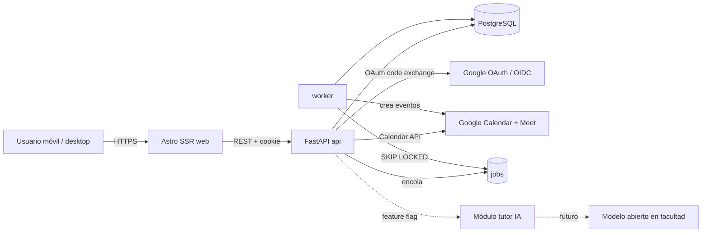

# Arquitectura y backlog — Sistema de tutorías universitario

> Documento de diseño para el piloto. Versión 0.1.
> Alcance: menos de 50 usuarios, 2–3 cursos, interfaz web mobile-first, despliegue con Docker,
> login Google institucional, programador de sesiones y tutor IA en stand-by.

## 1. Resumen ejecutivo

Se propone un **monolito modular** con dos procesos desplegables:

- `web`: interfaz Astro (SSR) mobile-first.
- `api`: FastAPI + SQLAlchemy + PostgreSQL, con un worker para tareas de asignación y recálculo.
- `db`: PostgreSQL.
- `worker`: mismo código de la API, ejecutando trabajos en segundo plano (sin Redis en el piloto).

No se usan microservicios: con menos de 50 usuarios el costo operativo supera cualquier beneficio.
La separación en contenedores es solo de despliegue, no de dominio, lo que permite mover el sistema
a cualquier host con Docker sin depender de un proveedor.

Decisiones clave:

| Tema | Decisión |
|---|---|
| Frontend | Astro con SSR (`output: server`) e islas interactivas mínimas |
| Backend | Python 3.12 + FastAPI + SQLAlchemy 2 + Alembic |
| Base de datos | PostgreSQL 16 |
| Autenticación | Google OAuth 2.0 / OpenID Connect, restringido al dominio institucional |
| Sesiones web | Cookie `HttpOnly` firmada emitida por la API; sin JWT en `localStorage` |
| Trabajos | Tabla `jobs` + worker con `FOR UPDATE SKIP LOCKED` (sin Celery/Redis en el piloto) |
| Meet | Google Calendar API con `conferenceData` (Meet). Sujeto a aprobación del tenant |
| Tutor IA | Módulo aislado detrás de una interfaz, deshabilitado por feature flag |
| Infraestructura | Docker Compose; variables de entorno; sin servicios propietarios obligatorios |

## 2. Contexto y restricciones

### 2.1 Reglas del piloto

- Menos de 50 usuarios activos.
- 2 o 3 cursos.
- Máximo **6 estudiantes por tutor**.
- Evaluación de **6 preguntas**: 2 fáciles, 3 intermedias, 1 difícil.
- El tutor IA está en **stand-by** hasta elegir el modelo; se evaluará un modelo abierto
  alojado en servidores de la facultad.

### 2.2 Supuestos a validar

1. **"Máximo 6 estudiantes por tutor"** se interpreta como máximo 6 estudiantes por **grupo/sesión**.
   Si el requisito significa máximo 6 estudiantes activos por tutor en todo el curso, el scheduler
   debe cambiar de "cupo por sesión" a "cupo por tutor y período". Ver sección 12.
2. La frecuencia y duración de las sesiones serán configurables por curso.
3. Los tutores son estudiantes avanzados o docentes con disponibilidad declarada.
4. La evaluación es diagnóstica/formativa y no reemplaza la evaluación oficial de la cátedra.
5. El tenant de Google es Google Workspace for Education y su administrador puede aprobar
   los scopes necesarios.

## 3. Diagrama de componentes



Flujo de despliegue (Docker Compose):

```text
reverse-proxy (opcional) -> web (Astro) -> api (FastAPI) -> db (Postgres)
                                          -> worker (mismo image que api)
```

## 4. Módulos del backend

El monolito se organiza por dominio, no por capa técnica:

```text
api/
  app/
    core/            # config, seguridad, sesiones, logging, errores
    auth/            # OAuth Google, RBAC
    academic/        # usuarios, cursos, inscripciones, tutores, disponibilidad
    scheduling/      # generación de grupos, sesiones, cancelaciones y recálculo
    meetings/        # adaptador Google Calendar/Meet + fallback ICS
    assessment/      # evaluaciones, preguntas, intentos, resultados
    ai_tutor/        # interfaz y adaptador del tutor IA (stand-by)
    jobs/            # cola en PostgreSQL y worker
    audit/           # registro de acciones sensibles
  migrations/        # Alembic
  tests/
```

Reglas de dependencia: `scheduling` no llama directamente a Google; usa la interfaz de `meetings`.
`ai_tutor` no conoce el scheduler ni la evaluación. `academic` no depende de `scheduling`.

## 5. Autenticación y autorización

### 5.1 Flujo OAuth

1. El usuario entra a `web` y pulsa "Continuar con Google".
2. `web` redirige a `GET /auth/google/login` en la API.
3. La API genera `state` + `nonce` + PKCE, los guarda en una cookie temporal firmada y redirige a Google.
4. Google devuelve el `code` a `GET /auth/google/callback`.
5. La API valida `state`, canjea el código, valida el ID token (firma, `iss`, `aud`, `exp`, `nonce`),
   verifica que el dominio del correo esté en `ALLOWED_DOMAINS` y que `email_verified` sea verdadero.
6. La API crea o actualiza el usuario, emite una sesión (cookie `HttpOnly`, `Secure`, `SameSite=Lax`)
   y redirige a la web.
7. `web` llama a `GET /auth/me` para renderizar el layout según el rol.

### 5.2 Roles

| Rol | Permisos |
|---|---|
| `student` | Ver sus sesiones, cancelar con antelación, responder evaluaciones, usar tutor IA |
| `tutor` | Ver sus grupos, disponibilidad, cancelar/reprogramar sesiones, ver evaluaciones de sus estudiantes |
| `coordinator` | Gestionar cursos, tutores, inscripciones, ejecutar el scheduler y ver reportes |

Un usuario puede tener más de un rol (por ejemplo, estudiante que también es tutor).
El rol se guarda en la tabla `user_roles`, no en el token.

### 5.3 Seguridad

- Scopes mínimos: `openid email profile` y, si se aprueba Meet, `calendar.events`.
- Tokens de Google **solo** en el servidor; nunca se envían al navegador.
- Refresh tokens cifrados en reposo si se guardan (Meet requiere acceso duradero al calendario).
- CSRF: `state` en OAuth y token CSRF en formularios mutantes de Astro.
- Rate limiting en login, evaluación y tutor IA.
- Registro de auditoría para: ejecución del scheduler, cancelaciones, cambios de rol,
  creación de eventos y accesos a datos de estudiantes.
- Datos personales mínimos: nombre, correo institucional, rol, inscripciones. Sin RUT ni notas oficiales.
- Retención: transcripciones de IA y adjuntos con vencimiento configurable (por defecto, 90 días).

## 6. Modelo de datos

Tablas principales (SQLAlchemy):

### Identidad y academia

| Tabla | Campos relevantes |
|---|---|
| `users` | `id` UUID, `google_sub` único, `email` único, `name`, `picture_url`, `is_active`, `created_at` |
| `user_roles` | `user_id`, `role` (`student`/`tutor`/`coordinator`) |
| `courses` | `id`, `code`, `name`, `term`, `session_duration_min`, `sessions_per_cycle`, `is_active` |
| `enrollments` | `id`, `course_id`, `student_id`, `status` (`active`/`withdrawn`), `unique(course_id, student_id)` |
| `tutor_courses` | `tutor_id`, `course_id`, `max_students` (default 6), `unique` |
| `availability_slots` | `id`, `tutor_id`, `weekday`, `start_time`, `end_time`, `course_id` nullable |
| `student_availability` | `id`, `student_id`, `weekday`, `start_time`, `end_time` (opcional, para evitar choques) |

### Programación

| Tabla | Campos relevantes |
|---|---|
| `scheduler_runs` | `id`, `course_id`, `trigger` (`manual`/`cancellation`/`batch`), `status`, `started_at`, `finished_at`, `stats_json` |
| `groups` | `id`, `course_id`, `tutor_id`, `name`, `capacity` (default 6), `status` (`draft`/`active`/`closed`) |
| `group_members` | `group_id`, `student_id`, `joined_at`, `unique(group_id, student_id)` |
| `sessions` | `id`, `group_id`, `scheduler_run_id`, `starts_at`, `ends_at`, `status` (`scheduled`/`cancelled`/`completed`), `meeting_url`, `calendar_event_id`, `cancel_reason` |
| `cancellations` | `id`, `session_id`, `requested_by`, `reason`, `created_at`, `reassigned` |
| `session_attendance` | `session_id`, `student_id`, `status` |

Restricción crítica en base de datos: un grupo no puede superar `capacity` (6). Se implementa con
validación transaccional en el servicio y, como defensa adicional, un trigger o `CHECK` sobre un
contador materializado en `groups.active_members`.

### Evaluación

| Tabla | Campos relevantes |
|---|---|
| `assessments` | `id`, `course_id`, `title`, `status` (`draft`/`open`/`closed`), `opens_at`, `closes_at` |
| `questions` | `id`, `assessment_id`, `difficulty` (`easy`/`medium`/`hard`), `position`, `body`, `type`, `options_json`, `correct_json` |
| `attempts` | `id`, `assessment_id`, `student_id`, `started_at`, `submitted_at`, `score` |
| `answers` | `id`, `attempt_id`, `question_id`, `response_json`, `is_correct`, `points` |

Regla de negocio: al publicar una evaluación se valida exactamente `2 easy + 3 medium + 1 hard`.
La regla vive en el servicio y en un test de integración, no solo en la UI.

### Tutor IA

| Tabla | Campos relevantes |
|---|---|
| `ai_conversations` | `id`, `user_id`, `course_id` nullable, `created_at`, `expires_at` |
| `ai_messages` | `id`, `conversation_id`, `role`, `content`, `attachments_json`, `tokens`, `created_at` |
| `ai_feedback` | `id`, `message_id`, `user_id`, `rating`, `comment` |

### Infraestructura interna

| Tabla | Campos relevantes |
|---|---|
| `jobs` | `id`, `type`, `payload_json`, `status`, `attempts`, `run_after`, `locked_by`, `locked_at`, `last_error` |
| `audit_log` | `id`, `actor_id`, `action`, `entity`, `entity_id`, `metadata_json`, `created_at` |
| `feature_flags` | `key`, `enabled`, `description` |

Índices: `sessions(starts_at, status)`, `group_members(student_id)`, `jobs(status, run_after)`,
`users(email)`, `availability_slots(tutor_id, weekday)`.

## 7. Programador de sesiones

### 7.1 Objetivo

Asignar en lote estudiantes a tutores y generar sesiones, respetando:

- Tutor habilitado para el curso.
- Capacidad máxima de 6 por grupo.
- Disponibilidad del tutor y, si existe, del estudiante.
- Duración y frecuencia configuradas por curso.
- Carga equilibrada entre tutores.
- Mínima disrupción al recalcular (no reasignar grupos que ya funcionan).

### 7.2 Algoritmo propuesto (fase piloto)

Para menos de 50 usuarios, un algoritmo determinista es suficiente y auditable:

1. Cargar estudiantes activos sin grupo, tutores habilitados, su disponibilidad y cupos.
2. Ordenar estudiantes por **menor número de tutores compatibles** (los más restringidos primero).
3. Para cada estudiante, elegir el grupo compatible con:
   - cupo disponible,
   - intersección de disponibilidad,
   - menor carga actual,
   - desempate estable por `tutor_id` (reproducibilidad).
4. Si no hay grupo, abrir un grupo nuevo con un tutor compatible y cupo.
5. Si ningún tutor es compatible, marcar al estudiante como `unassigned` con motivo
   (`sin_disponibilidad`, `sin_tutor`, `cupo_lleno`) y devolverlo en el reporte de la ejecución.
6. Persistir todo en una transacción; registrar `scheduler_runs.stats_json`.

No se usa optimización combinatoria en el piloto. Si aparecen casos sin solución, se evalúa
backtracking o un solver (OR-Tools) en una fase posterior, midiendo primero la tasa de no asignados.

### 7.3 Recálculo por cancelación

Casos:

- **Cancela el tutor / se cancela la sesión completa:** los estudiantes del grupo vuelven a la bolsa.
  El recálculo intenta primero reubicarlos en grupos existentes con cupo y disponibilidad compatible;
  solo si no es posible, crea una nueva sesión/grupo. Se preservan los demás grupos.
- **Cancela un estudiante:** se libera su cupo; no se recalcula todo, solo se registra la baja y se
  ofrece el cupo al primer estudiante no asignado compatible.
- **Cambio de disponibilidad de un tutor:** se recalcula solo ese tutor.

Propiedades exigidas:

- Idempotente: ejecutar dos veces el mismo recálculo no duplica grupos ni sesiones.
- Acotado: nunca supera 6 estudiantes por grupo.
- Auditable: cada movimiento queda ligado a un `scheduler_run` y al `audit_log`.
- No silencioso: todo estudiante sin asignar aparece en el reporte.

### 7.4 Ejecución

- La API encola un job `scheduling.run` o `scheduling.recalculate`.
- El worker toma el job con `SELECT ... FOR UPDATE SKIP LOCKED`, lo ejecuta y guarda estadísticas.
- La UI consulta `GET /scheduler/runs/{id}` para mostrar progreso y resultado.
- Se impide ejecutar dos recálculos simultáneos del mismo curso con un advisory lock de PostgreSQL.

### 7.5 Criterios de aceptación

- Menos de 5 segundos para 50 usuarios y 3 cursos.
- 100 % de los grupos con 6 o menos integrantes.
- Reporte con asignados, no asignados y motivo.
- Test de propiedad: ninguna ejecución produce grupos sobrecapacitados ni estudiantes duplicados.
- Recálculo tras cancelación preserva al menos el 80 % de las asignaciones válidas previas.

## 8. Integración con Google Meet

### 8.1 Enfoque

Usar Google Calendar API v3 al crear cada sesión:

- `events.insert` con `conferenceDataVersion=1` y `conferenceData.createRequest` de tipo `hangoutsMeet`.
- Guardar `calendar_event_id` y `meeting_url` en `sessions`.
- Actualizar el evento al reprogramar y cancelarlo al cancelar la sesión.
- Invitar a tutor y estudiantes como asistentes (o publicar el enlace en la UI si se prefiere no
  invitar por correo).

### 8.2 Requisitos y riesgos

| Riesgo | Impacto | Mitigación |
|---|---|---|
| El admin del tenant no aprueba `calendar.events` | Alto | Validar en la fase 0; si no se aprueba, activar fallback |
| Política institucional bloquea Meet | Alto | Decisión temprana con TI; documentar replanteamiento |
| El usuario no es Workspace (cuenta personal) | Medio | Restringir dominio; no permitir cuentas externas |
| Refresh token revocado | Medio | Marcar sesión como `meeting_pending` y pedir reautorización |
| Zona horaria incorrecta | Medio | Guardar todo en UTC y renderizar en `America/Santiago` configurable |

### 8.3 Fallback si Meet no es viable

1. La sesión se crea igualmente en la base de datos con `meeting_url = null`.
2. El sistema ofrece generar un archivo `.ics` descargable y un campo para pegar un enlace manual
   (Zoom, Teams o Meet creado a mano).
3. El tutor recibe un recordatorio para completar el enlace.
4. La UI muestra "enlace pendiente" en lugar de un botón roto.

Este fallback cumple el requisito "si no es posible, se replantea" sin bloquear el resto del piloto.

### 8.4 Spike obligatorio (fase 0)

Antes de comprometer fechas, ejecutar una prueba de 1 día:

- Crear un evento con Meet usando OAuth de una cuenta institucional.
- Confirmar que la organización permite conceder el scope.
- Medir si el enlace se genera en la cuenta del coordinador o requiere delegación.

Sin este spike, la integración de Meet queda como riesgo abierto, no como compromiso.

## 9. Tutor IA (stand-by)

### 9.1 Alcance

El tutor IA responde con texto, fórmulas y análisis de fotos de ejercicios. **No** se habilita en
producción hasta definir el modelo. El piloto puede construirse completo sin él.

### 9.2 Diseño para no bloquear

Interfaz estable, independiente del proveedor:

```python
class TutorModel(Protocol):
    async def reply(self, messages: list[Message], attachments: list[Attachment]) -> ModelReply: ...
```

Adaptadores previstos:

- `MockTutor` para desarrollo y pruebas.
- `OpenSourceTutor` para el modelo abierto en servidores de la facultad (futuro).

La API expone `POST /ai/conversations/{id}/messages` detrás del flag `ai_tutor_enabled`.
Si el flag está apagado, responde `503` con un mensaje claro y la UI oculta la entrada.

### 9.3 Requisitos técnicos para el modelo futuro

- Soporte multimodal (imagen) y salida con fórmulas en LaTeX.
- Renderizado en Astro con KaTeX (o MathJax) y optimización de imágenes.
- Límite de tamaño y tipo de archivo; almacenamiento fuera de la base (volumen o S3 compatible).
- Prompt de sistema con alcance del curso y prohibición de resolver evaluaciones abiertas.
- Registro de conversaciones y feedback para evaluar calidad.
- Privacidad: no entrenar con datos de estudiantes sin consentimiento explícito.
- Presupuesto y latencia medidos antes de habilitar; GPU en facultad condiciona el despliegue.

### 9.4 Criterios de salida del stand-by

1. Modelo elegido y probado con 20 ejercicios reales del curso.
2. Precisión aceptable en texto, fórmula y foto según rúbrica del coordinador.
3. Aprobación de privacidad y seguridad por la facultad.
4. Costo y latencia dentro del presupuesto del piloto.

## 10. Frontend Astro

### 10.1 Enfoque

- Astro con `output: 'server'` y adaptador Node.
- Componentes server-side para páginas; islas (`client:load`) solo para calendario, formularios
  interactivos, chat y evaluación.
- CSS mobile-first, sin framework pesado; se puede usar Tailwind si el equipo ya lo domina.
- Sesión leída en el servidor desde la cookie; no se expone token al cliente.

### 10.2 Rutas principales

| Ruta | Contenido |
|---|---|
| `/` | Login o dashboard según sesión |
| `/dashboard` | Próximas sesiones, estado de asignación |
| `/sessions` | Listado y detalle; botón de Meet; cancelar |
| `/availability` | Disponibilidad del tutor |
| `/assessment/[id]` | Evaluación de 6 preguntas con guardado de progreso |
| `/tutor` | Chat del tutor IA (oculto si flag apagado) |
| `/admin/courses` | Gestión de cursos e inscripciones |
| `/admin/scheduler` | Ejecutar asignación, ver reporte y no asignados |
| `/admin/assessments` | Crear evaluación validando 2/3/1 |

### 10.3 Accesibilidad y móvil

- Objetivos táctiles de al menos 44 px.
- Navegación inferior en móvil.
- Formularios con etiquetas visibles y errores anunciados.
- Contraste AA y soporte de teclado en escritorio.

## 11. Infraestructura y operación

### 11.1 Docker

Servicios de `compose.yaml`:

| Servicio | Imagen | Notas |
|---|---|---|
| `web` | build multi-stage Node | Astro SSR en modo standalone |
| `api` | build multi-stage Python | Uvicorn, usuario no root |
| `worker` | misma imagen que `api` | Comando distinto |
| `db` | `postgres:16-alpine` | Volumen persistente, healthcheck |
| `proxy` | Caddy o Nginx (opcional) | TLS y enrutamiento |

- Configuración solo por variables de entorno (`.env.example` versionado, `.env` ignorado).
- Sin dependencias de un cloud específico: cualquier host con Docker Compose sirve.
- Migraciones con Alembic al desplegar (`api` ejecuta `alembic upgrade head` antes de arrancar).
- Healthchecks en `api` (`/health`) y `db`.
- Backups diarios de PostgreSQL con retención de 14 días.

### 11.2 Observabilidad

- Logs JSON a stdout con `request_id`, `user_id` y latencia.
- Endpoint `/health` y `/ready`.
- Métricas mínimas: ejecuciones del scheduler, asignados/no asignados, errores de Meet, latencia de IA.
- Alertas simples por correo al coordinador si falla una ejecución o un job queda reintentando.

### 11.3 Entornos

- `dev`: Docker Compose con recarga en caliente y `MockTutor`.
- `pilot`: un host de la facultad o VM institucional; TLS obligatorio; base de datos con backup.
- No se crea entorno de staging separado en el piloto por costo; se usa una base de datos de prueba
  y despliegues controlados.

## 12. Decisiones abiertas

Estas preguntas deben resolverse antes de implementar el scheduler y la evaluación:

1. ¿"Máximo 6 estudiantes por tutor" es por sesión o total por curso/período?
2. ¿Quién declara la disponibilidad y con cuánta antelación se cierra?
3. ¿Frecuencia y duración de las sesiones por curso?
4. ¿La evaluación es requisito para asignar tutor o es solo diagnóstica?
5. ¿Las 6 preguntas son iguales para todos los cursos o se parametrizan por curso?
6. ¿Qué pasa cuando un estudiante no puede ser asignado? ¿Se le muestra un mensaje o el
   coordinador lo resuelve manualmente?
7. ¿Se invita por correo a los estudiantes a los eventos de Calendar o solo se muestra el enlace?
8. ¿El tenant permite `calendar.events`? Resultado del spike de la fase 0.
9. ¿Qué modelo abierto y qué hardware hay disponibles para el tutor IA?
10. ¿Cuánto tiempo se retienen transcripciones y fotos?

## 13. Backlog priorizado

Estimación en puntos de historia (1 punto ≈ media jornada). El orden respeta dependencias.

### Fase 0 — Validación y cimientos (1 semana)

| ID | Historia | Criterios de aceptación | Pts |
|---|---|---|---|
| E0-1 | Spike de Google OAuth institucional | Login exitoso con cuenta del dominio; cuenta externa rechazada | 3 |
| E0-2 | Spike de Google Calendar/Meet | Evento con enlace de Meet creado desde una cuenta institucional; decisión go/no-go documentada | 3 |
| E0-3 | Esqueleto del monorepo | `web`, `api`, `worker`, `db` levantan con `docker compose up`; `/health` responde | 3 |
| E0-4 | CI mínima | Tests y lint de Python y Astro en cada push | 2 |
| E0-5 | Definir respuestas de la sección 12 | Documento actualizado con decisiones del coordinador | 1 |

### Fase 1 — Identidad y datos académicos (1,5 semanas)

| ID | Historia | Criterios de aceptación | Pts |
|---|---|---|---|
| E1-1 | Login con Google y sesión | Cookie segura, logout, `/auth/me`, dominio restringido | 5 |
| E1-2 | Roles y autorización | `student`, `tutor`, `coordinator`; rutas protegidas por rol | 3 |
| E1-3 | Gestión de cursos e inscripciones | Coordinador crea cursos y asocia estudiantes; duplicados rechazados | 5 |
| E1-4 | Perfil y disponibilidad de tutor | Tutor declara bloques horarios por curso | 3 |
| E1-5 | Layout móvil base | Navegación inferior, dashboard vacío, sesión visible | 3 |

### Fase 2 — Programador de sesiones (2 semanas)

| ID | Historia | Criterios de aceptación | Pts |
|---|---|---|---|
| E2-1 | Modelo de grupos, sesiones y jobs | Migraciones y restricciones de capacidad | 3 |
| E2-2 | Asignación en lote | Genera grupos ≤ 6, respeta disponibilidad y devuelve reporte | 8 |
| E2-3 | Recalculo por cancelación | Reasigna afectados, preserva el resto, es idempotente | 8 |
| E2-4 | Panel del coordinador | Ejecutar, ver progreso, ver asignados y no asignados con motivo | 5 |
| E2-5 | Sesiones del estudiante/tutor | Listado, detalle y cancelación con antelación | 5 |
| E2-6 | Tests del scheduler | Propiedades de capacidad, duplicados e idempotencia | 5 |

### Fase 3 — Reuniones (1 semana, condicionada al spike)

| ID | Historia | Criterios de aceptación | Pts |
|---|---|---|---|
| E3-1 | Adaptador Calendar/Meet | Crear, actualizar y cancelar eventos; guardar enlace | 5 |
| E3-2 | Fallback sin Meet | `.ics` descargable y enlace manual; UI de "pendiente" | 3 |
| E3-3 | Reintentos y errores | Job reintenta con backoff; estado visible al coordinador | 3 |

### Fase 4 — Evaluación (1,5 semanas)

| ID | Historia | Criterios de aceptación | Pts |
|---|---|---|---|
| E4-1 | CRUD de evaluaciones y preguntas | Publicar exige 2 fáciles, 3 intermedias, 1 difícil | 5 |
| E4-2 | Rendición del estudiante | Guardado de progreso, envío único, tiempo límite opcional | 5 |
| E4-3 | Resultados | Puntaje por dificultad y vista para tutor/coordinador | 3 |
| E4-4 | Tests de reglas | No se publica con distribución inválida | 2 |

### Fase 5 — Tutor IA (bloqueada hasta definir modelo)

| ID | Historia | Criterios de aceptación | Pts |
|---|---|---|---|
| E5-1 | Contrato e interfaz `TutorModel` | `MockTutor` responde texto y fórmula; flag apagado por defecto | 3 |
| E5-2 | Chat con texto y LaTeX | Renderizado correcto en móvil; historial persistido | 5 |
| E5-3 | Fotos de ejercicios | Subida validada, análisis y respuesta; límites de tamaño | 5 |
| E5-4 | Adaptador del modelo abierto | Latencia y calidad medidas; aprobación de privacidad | 8 |
| E5-5 | Guardrails | No resuelve evaluaciones abiertas; mensajes de alcance | 3 |

### Fase 6 — Operación del piloto (continuo)

| ID | Historia | Criterios de aceptación | Pts |
|---|---|---|---|
| E6-1 | Auditoría y backups | Acciones sensibles registradas; restauración probada | 3 |
| E6-2 | Métricas y alertas | Dashboard básico de uso y fallos | 3 |
| E6-3 | Guía de uso | Documento breve para coordinador, tutores y estudiantes | 2 |
| E6-4 | Cierre y evaluación del piloto | Reporte con asignaciones, uso, incidentes y recomendación | 3 |

### Fuera de alcance del piloto

- Aplicación móvil nativa.
- Notificaciones push.
- Integración con el LMS oficial.
- Analítica avanzada o machine learning para asignación.
- Múltiples tenants o federación con otros dominios.

## 14. Hoja de ruta sugerida

```text
Semana 1      Fase 0: spikes OAuth + Meet, esqueleto Docker, decisiones abiertas
Semanas 2-3   Fase 1: login, roles, cursos, disponibilidad, layout móvil
Semanas 4-5   Fase 2: scheduler, recálculo, panel, sesiones, tests
Semana 6      Fase 3: Meet o fallback
Semanas 7-8   Fase 4: evaluación 2/3/1 y resultados
Semanas 9+    Fase 5: tutor IA según decisión de modelo
Continuo      Fase 6: operación, métricas y cierre
```

El camino crítico es **Fase 0 (Meet)** y **Fase 2 (scheduler)**. El tutor IA no debe bloquear
el lanzamiento del piloto.

## 15. Riesgos principales

| Riesgo | Prob. | Impacto | Mitigación |
|---|---|---|---|
| Meet no aprobado por el tenant | Media | Alto | Spike temprano + fallback `.ics`/enlace manual |
| Requisito de "6 por tutor" ambiguo | Alta | Medio | Resolver en fase 0 antes de codificar |
| Scheduler deja estudiantes sin asignar | Media | Alto | Reporte con motivos + ajuste manual del coordinador |
| Modelo abierto sin GPU o sin aprobación | Alta | Medio | Tutor IA en stand-by; el piloto funciona sin él |
| Datos personales mal protegidos | Baja | Alto | Minimización, RBAC, auditoría, retención |
| Baja adopción en el piloto | Media | Medio | Guía de uso, onboarding y métricas semanales |

## 16. Definición de terminado del piloto

- 2–3 cursos con estudiantes y tutores reales.
- Asignación en lote y recálculo por cancelación funcionando con grupos ≤ 6.
- Sesiones visibles con enlace de Meet o fallback acordado.
- Evaluación de 6 preguntas (2/3/1) rendible y con resultados.
- Login institucional restringido al dominio.
- Despliegue reproducible con Docker Compose y backups verificados.
- Reporte final con métricas, incidentes y recomendación de continuidad.
